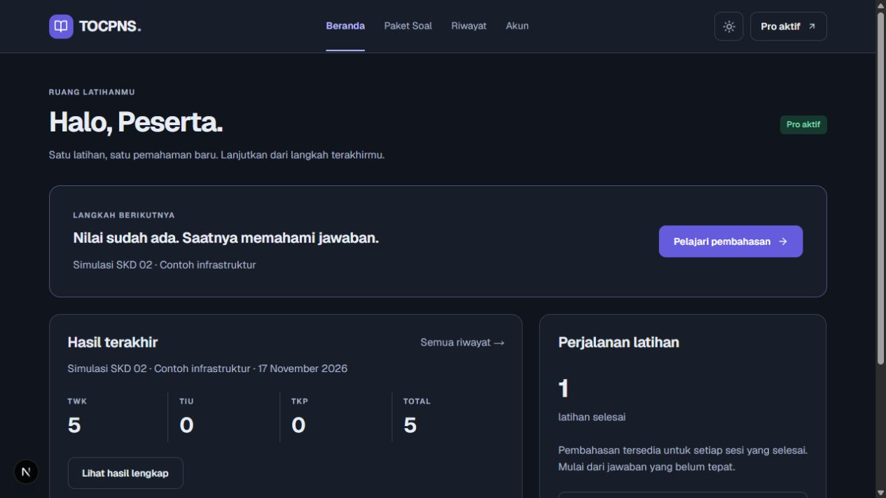
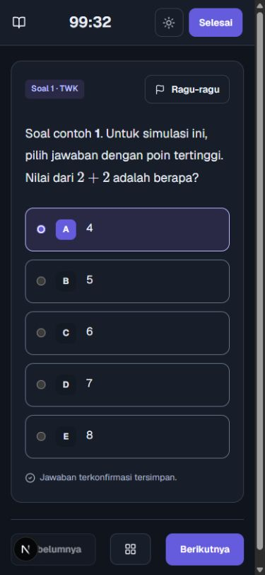
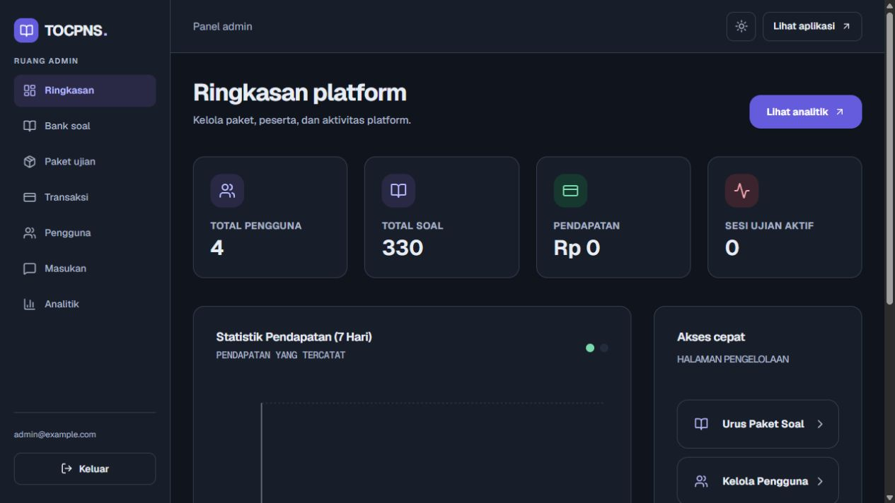

# Audit dan penyempurnaan tema TOCPNS

Tanggal: 17 November 2026. Seluruh perubahan berada lokal di `main`; tidak membuat branch, commit, push, atau deployment baru.

## Temuan awal

Tema gelap masih ada pada panel admin, tetapi belum menjadi sistem tema aplikasi. Halaman peserta memakai `.app-surface` dengan warna terang tetap, sementara admin memakai slate gelap secara langsung. Latar, formulir, badge, jawaban ujian, dan dialog tidak mengikuti satu preferensi. Tema bawaan OS pada `body` juga tidak cukup untuk mengubah kartu peserta.

Perbedaan lain: kartu admin terlalu membulat/berbayang, teks sekunder terlalu redup, sidebar ponsel terbuka sejak awal, dialog custom belum membatasi fokus secara native, beberapa tombol ikon tidak memiliki nama aksesibel, dan ada angka tren promosi yang tidak berasal dari data.

## Sistem yang diterapkan

- Satu palet semantic di `globals.css`: canvas, surface, ink, muted, line/control-line, accent, success, warning, danger dan warna grafik. Tidak memakai filter inversi atau menimpa seluruh warna halaman secara global.
- Latar gelap arang kebiruan, bidang kartu sedikit lebih terang, teks utama putih lembut, teks sekunder terbaca, dan aksen indigo. Tema terang dipertahankan sebagai pilihan setara.
- Tombol matahari/bulan pada header peserta, header ujian, dan toolbar admin. Opsi **Ikuti perangkat / Gelap / Terang** di Akun. Preferensi tersimpan per browser, tersinkron melalui event storage lintas tab, dan mengikuti perubahan preferensi OS ketika mode sistem dipilih.
- Bootstrap kecil pada `<head>` menentukan tema sebelum paint. Penyimpanan yang diblokir tidak membuat aplikasi gagal dibuka. Layout tetap dapat di-prerender; tidak menambah library tema atau membuat seluruh route dinamis hanya untuk membaca preferensi.
- Pilihan tema tidak terhubung dengan token login, hak Pro, jawaban, timer, atau scoring. Keluar akun tidak menghapus preferensi tema.
- Tombol, formulir, fokus keyboard, placeholder, autofill, dialog, toast, status/error, tabel, pagination, pilihan jawaban, navigator, hasil dan pembahasan memakai token yang sama.
- Diagram soal tetap memiliki alas putih; tidak diinversi. Rumus mengikuti warna teks dan bisa digulir bila melebar.
- Admin memakai shell baru yang lebih ringkas, sidebar desktop dan drawer ponsel yang tertutup secara default. Bentuk kartu dan tipografi lebih tenang, bayangan/glow dan hover scaling dekoratif dikurangi.
- Delapan dialog admin lama dipindahkan ke native dialog untuk Escape, fokus, dan pengembalian fokus. Form dukungan memakai dialog yang sama dengan peserta. Tambahan nama aksesibel untuk kontrol ikon/field dan tiga switch paket dapat dioperasikan sebagai tombol keyboard.
- Grafik memakai warna dan tooltip sesuai tema. Badge tren persentase yang tidak berasal dari data dihapus dari ringkasan/analitik admin. Link analitik/paket diperbaiki agar tidak menjadi tombol mati atau elemen interaktif bersarang.

## Cakupan 30 halaman

Seluruh 30 file `page.tsx` ditinjau. Error boundary dan 404 diperiksa sebagai komponen tambahan. Halaman yang memakai komponen sama tidak mendapat stylesheet duplikat.

| Kelompok | Halaman | Penanganan |
|---|---|---|
| Publik | `/`, `/catalog`, `/catalog/[id]`, `/catalog/upgrade`, `/faq`, `/support` | Header, CTA, kartu, pencarian, filter, keanggotaan, FAQ dan dialog dukungan mengikuti palet |
| Autentikasi | `/login`, `/register`, `/forgot-password`, `/reset-password` | Input, autofill, fokus, aksi kata sandi dan state token kosong/invalid tetap terbaca |
| Peserta | `/dashboard`, `/history`, `/account`, `/analytics`, `/leaderboard` | Hierarki ringkas, hasil/riwayat/transaksi, pilihan tema, state kosong/loading/error |
| Ujian | `/session/[id]`, `/session/[id]/result`, `/session/[id]/review` | Timer, radio, tanda ragu, navigator/modal, status ACK, submit, nilai, jawaban benar/pilihan peserta dan pembahasan |
| Pembayaran | `/payment/success`, `/payment/failed` | State status/nomor order kosong dan bantuan mengikuti tema; tidak menjalankan transaksi nyata |
| Admin | `/admin`, `/admin/packages`, `/admin/questions`, `/admin/users`, `/admin/transactions`, `/admin/feedback`, `/admin/analytics` | Shell, tabel, filter, form, pagination, native dialog, grafik dan toolbar mengikuti palet |
| Alias lama | `/exam/[id]`, `/exam/[id]/result`, `/exam/[id]/review` | Tetap menggunakan redirect/komponen sesi yang sudah ditata, tanpa mesin tema terpisah |
| Tambahan | 404 dan `error.tsx` | Memakai AppShell dan token yang sama. 404 diuji langsung; error boundary ditinjau dari sumber, tidak sengaja membuat crash baru |

## Pengukuran kontras token

Rasio berikut dihitung dari warna akhir, bukan klaim sertifikasi aksesibilitas seluruh aplikasi. Ambang yang ditargetkan: teks normal 4,5:1 dan batas input terhadap bidangnya 3:1.

| Pasangan | Terang | Gelap |
|---|---:|---:|
| Teks utama / kartu | 16,27:1 | 14,22:1 |
| Teks sekunder / kartu | 6,36:1 | 7,81:1 |
| Placeholder / kartu | 4,93:1 | 6,30:1 |
| Aksen / bidang aksen lembut | 5,55:1 | 7,67:1 |
| Label berhasil / bidang berhasil | 6,44:1 | 7,53:1 |
| Label peringatan / bidang peringatan | 6,02:1 | 8,40:1 |
| Label error / bidang error | 6,70:1 | 7,36:1 |
| Teks tombol / tombol utama | 6,29:1 | 5,13:1 |
| Teks tombol / hover tombol utama | 7,90:1 | 4,81:1 |
| Batas input / kartu | 3,24:1 | 3,51:1 |

## Verifikasi

- **11 unit tests lulus**: tujuh pengujian antrean/waktu ujian yang sudah ada, ditambah empat skenario bootstrap tema (preferensi eksplisit vs OS, reload, nilai preferensi invalid, dan localStorage diblokir).
- TypeScript dan build Next.js berhasil. Pemeriksaan lint halaman peserta dan komponen tema baru: 0 error; enam warning `` untuk diagram soal dipertahankan. Lint admin lama secara keseluruhan belum dijadikan gate bersih baru.
- Browser lokal memakai database/akun sintetis: peserta memilih jawaban → ACK → berpindah terang/gelap → pilihan tetap sama → navigator ponsel → dialog submit → hasil. Tidak ada perombakan backend atau penyimpanan jawaban pada pekerjaan tema ini.
- Preferensi tetap gelap setelah reload/navigasi/keluar akun. Opsi sistem di Akun mengikuti OS yang diamati. Skenario OS terang/gelap saat bootstrap dan storage terblokir dilengkapi unit test.
- Pemeriksaan browser mencakup halaman publik, keanggotaan, akun, riwayat, statistik, ranking, autentikasi, status pembayaran, hasil/pembahasan, 404, serta ketujuh halaman admin. Header/form/kartu/status menggunakan palet yang sama.
- Responsiveness diperiksa pada desktop dan viewport 390×844. Ujian dan navigator terbaca tanpa overflow horizontal badan halaman. Tabel admin yang lebar menggunakan scroll di kontainernya. Drawer admin ponsel tertutup sesudah memilih halaman.
- Dialog admin dibuka dalam tema terang dan gelap tanpa menyimpan perubahan atau menjalankan tindakan hapus/ubah peran/publikasi. Uji formulir masukan memakai data sintetis lokal.

Aplikasi publik, provider pembayaran/email, dan database production tidak diubah. Pemeriksaan ini tidak menggantikan audit screen reader/WCAG formal atau uji seluruh perangkat fisik. Data harga dan workflow bisnis legacy di admin tidak dimigrasikan oleh pekerjaan tema.

## Contoh tampilan

