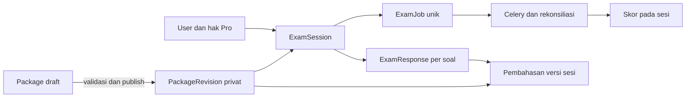
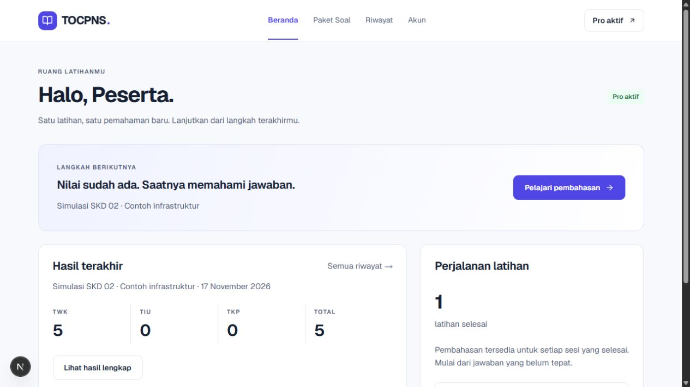

# Implementasi infrastruktur dan penyederhanaan TOCPNS

Tanggal: 17 November 2026. Branch kerja: `main`. Perubahan tetap lokal; jangan membuat branch baru atau melakukan push, sesuai `AGENTS.md`.

Implementasi ini mengubah mesin sesi dan pengalaman peserta di repositori. Database dan container production belum dipindahkan ke versi baru. Kualitas akademis bank soal tetap menjadi tahap berikutnya.

## Hasil yang sudah dibangun

| Area | Perilaku baru |
|---|---|
| Produk | Alur utama Paket → Persiapan → Ujian → Hasil → Pembahasan; navigasi Beranda, Paket Soal, Riwayat, Akun |
| AI | Chat, analisis hasil, dan digest peserta dihentikan dengan HTTP 410; komponen dan polling dihapus; data historis tidak dijatuhkan |
| Keanggotaan | Pro mengakses semua paket terbit/aktif/siap sesuai jadwal, tanpa pembelian paket satuan; keanggotaan dihitung backend; Pro legacy tanpa expiry dipertahankan |
| Penyimpanan | Jawaban sesi baru berada di `exam_responses`; ACK dikirim sesudah commit PostgreSQL; Redis bukan sumber jawaban yang diakui tersimpan |
| Konsistensi | Mutation ID, CAS revision, writer epoch/ID, satu sesi aktif, lock pengguna dan sesi, retry antrean lokal per tab |
| Waktu | Deadline absolut dan waktu server; refresh/resume tidak memberikan 100 menit baru; perubahan jam klien tidak melonggarkan deadline server |
| Penyelesaian | Submit menyimpan status processing dan job unik dalam transaksi; scoring idempotent, rekonsiliasi setiap 10 detik |
| Versi konten | Sesi dan preview mengikat snapshot privat; edit draft/publikasi baru tidak mengubah pertanyaan, bobot, atau pembahasan sesi tersebut |
| Publikasi | Validasi 110 soal, 30 TWK/35 TIU/45 TKP, nomor unik berurutan, opsi A–E, pembahasan, bobot; kegagalan struktur memblokir publish/start |
| Admin | Penyuntingan dan impor hanya pada draft dengan lock paket; impor replace tidak menghapus sesi/answer/chat; paket dengan histori legacy perlu disalin |
| Hasil | Nilai faktual per segmen, passing grade tersimpan dalam snapshot; pembahasan sesudah selesai; filter salah/kosong/TKP parsial dan laporan berkonteks sesi/versi/soal |
| Statistik | Menghapus angka promosi buatan/prediksi kelulusan; mastery TKP berdasarkan perolehan poin; peringkat hanya pada versi yang sama, tanpa email/ID publik, preview dikecualikan |
| Pembayaran | Offer dari backend; snapshot durasi per order; pending order yang masih berlaku digunakan kembali; signature/client/target/nominal diverifikasi; grant sekali per order; success tidak dibalik oleh notifikasi gagal yang terlambat |
| Autentikasi | `/me` tidak bergantung localStorage; return URL lokal; penolakan Origin asing untuk mutasi cookie; logout lintas tab memperhitungkan jawaban tertunda; login kedaluwarsa mempertahankan antrean dan memberi jalur masuk kembali |
| UI | Tema terang dan gelap dengan palet semantic, hierarki teks, ruang kosong, kartu ringkas, CTA jelas, mobile bottom navigation, radio keyboard, native dialog/focus, reduced motion, state loading/error/kosong |
| Operasi | Development DB terisolasi, startup tanpa auto-migration, schema gate, rehearsal migrasi, verifikasi image disposable, backup scripts privat, request ID/durasi, endpoint agregat admin |

Penawaran mengikuti konfigurasi yang sudah ada: Rp50.000 untuk 365 hari, DOKU tetap sandbox. Ini tidak mengaktifkan pembayaran uang nyata atau mengubah akun lama tanpa expiry. Ketersediaan checkout mengikuti konfigurasi backend.

## Model dan keputusan implementasi

1. **Snapshot JSON privat per revisi**, bukan tiga tabel versi soal/opsi terpisah. Snapshot berisi urutan, pertanyaan, opsi, bobot, pembahasan, durasi, dan ambang nilai. Digest menduplikasi konten identik. Sesi menyimpan FK revisi; ID jawaban diverifikasi terhadap snapshot, bukan draft yang bisa berubah. Tidak ada API untuk mengubah payload revisi. Kontrak immutable ada pada service; belum ada trigger database yang menolak SQL manual.
2. **Hasil tetap berada pada ExamSession**, satu baris per attempt; scoring memegang row lock. Tidak dibuat tabel hasil kedua dengan informasi yang sama. Preview memakai snapshot dan response sendiri, tidak masuk statistik peserta.
3. **ExamJob menjadi outbox scoring sederhana** dengan unique session. Dispatch gagal tidak menghapus niat scoring. Rekonsiliasi tidak memerlukan broker untuk membaca job, tetapi masih memerlukan proses beat aktif. Belum ada backoff per job, dead-letter UI, atau alert otomatis.
4. **Grant pembayaran memakai transaksi yang sudah ada**, `duration_days` dan `granted_at`, bukan ledger MembershipGrant terpisah. Row lock dan status success terminal mencegah grant ganda. Penyimpanan lengkap event mentah provider, audit event terpisah, dan rekonsiliasi API provider belum dibangun; ini bagian penguatan pembayaran sebelum uang nyata.
5. **Antrean lokal memakai localStorage per tab**, bukan IndexedDB. Ukurannya terbatas pada pilihan/revisi/tanda ragu dan tidak menyimpan naskah 110 soal. Owner/session mencegah pemulihan jawaban lintas akun. Jawaban lokal belum dianggap diterima sebelum ACK. Cache browser dibersihkan pengguna, storage penuh, atau perangkat hilang tetap dapat menghilangkan pilihan yang belum terkirim.
6. **Sesi legacy tetap dibaca lewat adapter lama.** Tidak ada snapshot fiktif/backfill jawaban dari skor agregat. Sesi lama belum memperoleh jaminan durabilitas mesin baru; sesi tersebut harus selesai/drain sebelum cutover produksi dinyatakan beres. Penyuntingan draft yang memiliki attempt legacy ditolak untuk menjaga pembahasan lama; gunakan salinan paket.
7. **Protocol gate untuk bundle lama.** Start/resume mesin baru membutuhkan `X-Exam-Protocol: 2`; client lama mendapat 409 `update_required` sebelum sesi baru dibuat atau payload modern dikirim. Sesi legacy tetap dapat diselesaikan lewat adapter. Header ini mengontrol kompatibilitas, bukan hak akses.
8. **Satu origin publik dipertahankan** melalui gateway/tunnel; port database/Redis tidak dipublikasikan production. Lingkungan verifikasi memakai subnet berbeda dan tidak memiliki port host, secret provider, atau volume production.

## Bukti verifikasi

- Seluruh suite backend pada PostgreSQL 16: **63 passed**. Mencakup konkurensi empat start bersamaan, durabilitas sesudah cache hilang, revisi usang, retry sesudah commit, opsi lintas soal, takeover writer, deadline/resume, submit ganda, publication gate, histori, akses Pro, checkout dan grant replay, serta ranking versi/preview dan tryout terjadwal yang tetap terlihat dengan alasan akses sebenarnya.
- Frontend: **7 unit tests passed**, TypeScript dan production build berhasil. Lint peserta: **0 error, 6 peringatan ``** untuk diagram soal/pembahasan. Lint admin lama belum dijadikan gate baru.
- Rehearsal Alembic **667ecbb432df → d8e4a91b2201** pada PostgreSQL kosong khusus: pengguna sintetis tetap ada, tabel baru kosong, kolom baru hadir; sekitar **5,88 detik** pada lingkungan lokal. Bukan estimasi durasi migrasi production.
- Backup/restore PostgreSQL sintetis ke database baru: arsip custom **113.030 byte**, hitungan user/sesi/response sama (**4/1/2**). Ini membuktikan jalur dump/restore lokal; backup production dan salinan terenkripsi luar host belum dibuktikan.
- Browser: login demo → katalog Pro → persiapan → mulai → pilih jawaban → ACK → refresh → jawaban/deadline tetap → mobile 390×844 → kirim → scoring worker → hasil → filter pembahasan. Nilai sintetis TWK 5/total 5 sesuai pilihan, tidak mengirim pembayaran/email nyata.
- Image runtime production dibangun dan diuji di folder privat review pada server dengan data sintetis: gateway/frontend, cookie Secure/HttpOnly/SameSite, CORS, secrecy jawaban, database ACK, worker/scoring, duplicate submit, schema gate, non-root dan konfigurasi Nginx lulus. Uji beban terbatas 10/25/50 peserta sintetis juga lulus: 85 alur start/save/resume memverifikasi ACK, dengan 50 baris response permanen.
- `npm audit --omit=dev`: **0 vulnerability** pada saat pemeriksaan. Full audit masih memiliki 7 moderate pada tool/transitive development; tidak dilakukan upgrade otomatis yang berisiko mengubah framework.

## Pengukuran beban terisolasi

Run bertahap pada server bersama, PostgreSQL/Redis disposable dan backend satu proses. Setiap alur melakukan start/resume, satu autosave, lalu GET state untuk memeriksa pilihan dan revision yang sudah ACK. Peserta dari tahap sebelumnya melanjutkan sesi yang sama. Ini burst pendek, bukan ujian 100 menit atau pengujian kapasitas production/Supabase.

| Peserta bersamaan | Alur berhasil | p95 autosave | p95 start/save/resume |
|---:|---:|---:|---:|
| 10 | 10/10 | 235,4 ms | 1.305,5 ms |
| 25 | 25/25 | 958,9 ms | 2.202,6 ms |
| 50 | 50/50 | 2.412,5 ms | 3.909,3 ms |

Seluruh 85 ACK cocok saat resume, dan 50 row jawaban ada di PostgreSQL. Latensi meningkat pada burst 50 peserta; angka ini menjadi baseline, bukan janji SLA atau klaim siap untuk ratusan/ribuan peserta. Uji internet, aset soal nyata, Supabase, scoring serentak, dan soak test tetap diperlukan sebelum menetapkan kapasitas publik. Semua container/jaringan `ujian-verify` dibersihkan setelah pemeriksaan; container production tidak diganti.

## Operasi dan batas kesiapan rilis

Schema production terakhir yang dibaca masih `667ecbb432df`; migrasi baru belum diterapkan. Image review terpisah tidak mengganti tag/config container aktif. File akses, token, connection string, dan salinan secret tidak dimasukkan Git.

API operasional baru:

- `GET /api/v1/health/live`: proses hidup, tidak mengecek database/worker.
- `GET /health`: kesiapan koneksi DB dan Redis yang sudah ada.
- `GET /api/v1/admin/analytics/infrastructure`: admin saja; pending job, umur job tertua, sesi lewat deadline, sesi legacy belum selesai, dan waktu ACK terakhir. Data ini bukan bukti worker/backup/provider sehat.

Yang masih menjadi syarat rilis produksi: backup production kompatibel beserta off-host encrypted copy dan restore rehearsal, inventaris sesi/job legacy saat cutover, E2E Google/email/reset/provider sandbox dengan konfigurasi deployment, pemeriksaan aset versi lama, jadwal cutover/rollback schema-compatible, dan pengamatan setelah rilis. Rincian ada di `redesign-release-runbook.md` dan backlog. Tidak ada klaim bahwa pemeriksaan akademis soal, aksesibilitas formal, kapasitas jangka panjang, atau pembayaran uang nyata telah selesai.

## Artefak review

Source runtime/backend/frontend/script yang diuji disimpan pada direktori review privat di server. Tag image review: `redesign-20261117-72f19a0b`; SHA-256 arsip source: `4801317bed5df606aa54c2f89f70a3353285da1d20bf72d7ffc0c6d907dc5c75`. Ini artefak pengujian sebelum commit, bukan manifest deployment production. Identitas image dan catatan akses operasional disimpan di `.server-notes/redesign-review-status.json` privat, tidak dimasukkan Git.

Compose production (termasuk profil public/operations/admin-ai) dan development divalidasi dengan konfigurasi sintetis tanpa mencetak secret. Pemeriksaan pola credential terhadap 277 kandidat file Git tidak menemukan private key/token yang cocok, dan tidak ada path privat yang eligible untuk Git. Pemeriksaan pola adalah pelengkap review, bukan jaminan mendeteksi semua jenis secret.

Penyempurnaan tampilan berikutnya: lihat `dark-theme-review-2026-11-17.md` untuk audit 30 halaman, pilihan tema dan QA terbaru. Perubahan tetap lokal di `main`, tanpa push atau branch baru.
