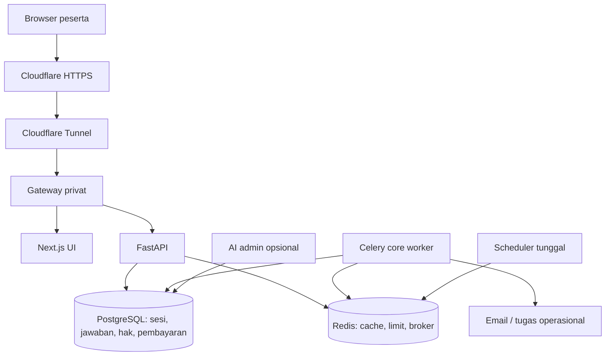
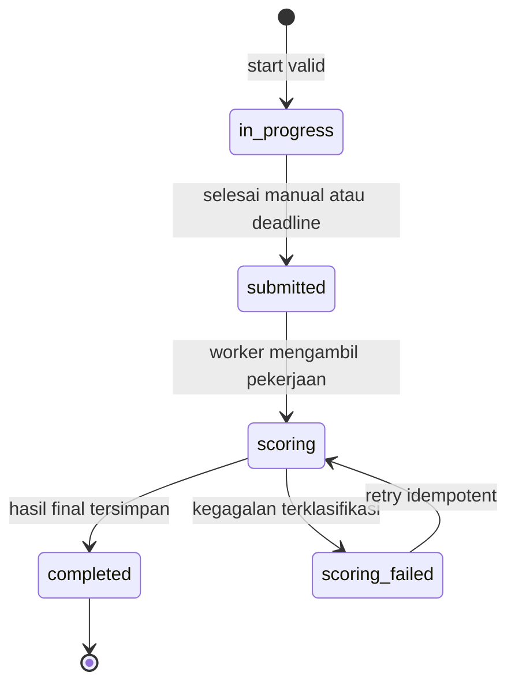

# Rencana perombakan infrastruktur, fitur, dan UI/UX TOCPNS

Tanggal: 17 November 2026. Status: rencana implementasi; belum ada perubahan aplikasi atau production.

Dasar: audit `docs/product-audit-2026-11-17.md`, kode `main` pada commit `7fab080`, konfigurasi production, pipeline deployment, serta lingkungan pengujian yang sudah ada. Kondisi server tidak diperiksa ulang dalam penyusunan rencana ini.

## 1. Tujuan dan batas pekerjaan

Membangun aplikasi latihan yang sederhana bagi peserta, rapi secara visual, dan mempunyai fondasi data yang dapat dipercaya. Fokus pekerjaan sekarang adalah infrastruktur aplikasi: perilaku fitur, model keanggotaan, penyimpanan, aturan akses, halaman, komponen UI, deployment, pengujian, dan pemantauan.

Siklus utama: **pilih paket → kerjakan → lihat hasil → pelajari pembahasan → latihan lagi**.

Keputusan pengguna sebelumnya tetap berlaku: **AI peserta dihapus; alat AI admin tetap opsional**. Dalam rancangan ini AI admin tidak aktif secara default dan tidak menjadi ketergantungan ujian. Jika kelak seluruh AI ingin dibuang, modul admin tersebut dapat dilepas tanpa mengubah mesin ujian.

Yang termasuk:

- Penghapusan AI peserta sampai API dan background task.
- Satu model Pro yang mudah dimengerti; seluruh paket peserta yang siap termasuk selama masa aktif.
- Penyimpanan jawaban yang tahan retry, timer benar, resume, scoring, dan hasil konsisten.
- Versi paket untuk menjaga sesi/histori ketika bank soal diedit.
- Validasi teknis sebelum publikasi; dukungan alur kerja admin untuk pekerjaan kualitas soal berikutnya.
- Desain visual, navigasi, responsivitas, aksesibilitas, dan keadaan loading/error/kosong.
- Keamanan akses, pembayaran, observabilitas, backup/restore, pengujian, dan rollout.

Yang dikerjakan pada fokus kualitas soal berikutnya:

- Menulis/memperbaiki substansi pertanyaan, kunci, bobot, dan pembahasan satu per satu.
- Memvalidasi relevansi materi, sumber resmi, tingkat kesulitan, dan kualitas pedagogis.
- Menambah paket SKB atau bank soal baru.

Pemisahan penting: mesin harus menolak publikasi paket kosong/tidak memenuhi spesifikasinya sekarang, tetapi penambahan enam soal TIU atau koreksi bobot tertentu masuk pekerjaan editorial. Paket bermasalah dapat tetap berada sebagai draft tanpa menghambat pembangunan infrastrukturnya.

## 2. Gambaran hasil akhir

Peserta hanya perlu memahami empat tujuan navigasi: **Beranda, Paket Soal, Riwayat, Akun**. Saat ujian, navigasi berubah menjadi shell khusus yang fokus pada soal dan waktu. Pembahasan menjadi tindakan utama sesudah hasil keluar.

Pro aktif melihat “Termasuk keanggotaan”, bukan dorongan membeli paket yang sebenarnya sudah dimiliki. Tidak ada chat AI, tombol generate, badge AI, atau layar menunggu AI. Status jawaban dan pembayaran berasal dari server, bukan teks sukses tetap.

Perubahan besar terjadi pada keteraturan sistem, bukan jumlah teknologi. Pertahankan Next.js, FastAPI, PostgreSQL Supabase, Redis, Celery, Docker Compose, gateway, dan Cloudflare Tunnel. Refactor sebagai **satu backend dengan modul domain yang jelas**, bukan memecah menjadi microservices.

Kriteria produk yang dituju:

1. Peserta tahu tindakan utama berikutnya tanpa membaca seluruh halaman.
2. Tidak ada jawaban berlabel “tersimpan” sebelum transaksi database berhasil.
3. Refresh, koneksi putus, retry, dan restart worker tidak menggandakan sesi atau hasil.
4. Hak paket, masa Pro, dan status pembayaran sama di semua halaman dan API.
5. Pengeditan paket tidak mengubah isi sesi berjalan atau makna histori baru.
6. Rilis bisa diperiksa dan dipulihkan tanpa membuang jawaban peserta.

## 3. Keputusan produk untuk rilis pertama

| Area | Keputusan rencana |
| --- | --- |
| Tingkat akses | Gratis dan satu Pro; tanpa Bronze/Gold/Platinum |
| Harga/durasi baru | Rekomendasi awal mempertahankan Rp50.000/365 hari agar sesuai backend; belum mengubah ketentuan transaksi atau hak lama |
| Perpanjangan | Pembelian eksplisit; tidak menambahkan auto-debit atau biaya berulang |
| Paket Pro | Semua paket peserta terbit/aktif/siap dalam cakupan layanan, mengikuti jadwal jika ada |
| Paket gratis | Pertahankan penetapan yang ada untuk fase infrastruktur; jangan sekaligus mengubah funnel dan hak akses |
| Pembelian per paket | Tidak ditambahkan; field/data transaksi lama tidak langsung dihapus |
| AI peserta | Dihapus menyeluruh |
| AI admin | Opsional, default mati, modul dan antrean terpisah |
| Analitik | Skor dan perkembangan faktual; tanpa klaim probabilitas lolos |
| Peringkat | Sekunder; hanya data yang layak dibandingkan |
| Donasi | Di halaman dukungan; keluar dari dashboard/navigasi utama |
| Tryout mingguan | Kemampuan backend dipertahankan; tampilan hanya jika acara tersedia |
| Branding | Usulan nama tampilan TOCPNS; satu istilah keanggotaan: Pro |
| Tema | Rancangan awal terang dengan putih hangat, teks gelap, aksen indigo; tema gelap menyusul setelah satu tema lolos QA |

Tema terang merupakan keputusan desain awal untuk menonjolkan bacaan soal dan mengurangi dekorasi gelap/glow yang sekarang dominan. Ini belum hasil preferensi pengguna. Sebelum pembangunan semua halaman, prototipe beranda peserta, katalog, dan ujian pada desktop/ponsel menjadi titik review visual. Jika tema gelap dipilih pada review itu, struktur, token, dan komponen tetap sama; hanya palet yang disesuaikan.

Janji komersial akhir, penanganan pelanggan yang pernah dijanjikan Lifetime/AI, dan pengaktifan pembayaran sungguhan perlu keputusan bisnis sebelum checkout baru dipublikasikan. Pengerjaan teknis lain tidak perlu menunggu keputusan itu; checkout dapat tetap sandbox/nonaktif untuk penjualan nyata.

## 4. Fitur: pertahankan, hilangkan, pindahkan

| Fitur sekarang | Hasil perombakan | Alasan |
| --- | --- | --- |
| Katalog, simulasi, nilai, riwayat | Pertahankan dan rapikan | Inti produk |
| Pembahasan | Perkuat navigasi dan keterbacaannya | Menghubungkan hasil dengan belajar |
| Chat mengambang, tutor per soal | Hapus | Mengurangi distraksi, biaya, dan dependensi peserta |
| AI analysis, Mastery Digest | Hapus | Tidak lagi menjadi manfaat Pro |
| Statistik TWK/TIU/TKP | Pertahankan | Dapat dihitung langsung dari jawaban |
| Confidence/prediksi kesiapan | Ganti ringkasan faktual | Rumus saat ini belum membuktikan peluang lolos |
| Badge Premium pada Pro | Ganti “Termasuk keanggotaan” | Menunjukkan hak yang sudah dimiliki |
| Wall of Fame, Tip Jar | Pindahkan ke Dukungan | Bukan tindakan utama peserta berbayar |
| MagicBento/profil developer | Ringkas di Tentang/footer | Memperpendek dashboard |
| Peringkat | Tab/tautan sekunder di hasil/acara | Menghindari persaingan dengan pembahasan |
| Publikasi admin | Tambah gerbang validasi dan versi | Melindungi peserta dari paket belum siap |
| Tombol tak berfungsi/angka promosi tanpa sumber | Perbaiki atau hilangkan | UI tidak menjanjikan hal yang tidak tersedia |

Belum ditambahkan: streak, badge prestasi baru, forum, live class, chatbot pengganti, aplikasi native, mode belajar adaptif, atau banyak varian paket berbayar. Semua itu memperluas ruang lingkup sebelum alur inti stabil.

## 5. Arsitektur target



Tujuh layanan inti yang ada tetap cukup: frontend, backend, worker, beat, Redis, gateway, dan tunnel. AI admin bila diaktifkan dapat memakai worker profil opsional; jangan menyalakan proses tambahan secara permanen sebelum anggaran resource diperiksa.

Pembagian tanggung jawab:

| Lapisan | Tanggung jawab |
| --- | --- |
| Frontend | Interaksi, status lokal tertunda, rendering soal aman, aksesibilitas |
| API | Identitas, otorisasi, aturan ujian, batas waktu, transaksi database |
| PostgreSQL | Catatan utama jawaban terkonfirmasi, sesi, hasil, versi, pembayaran, hak akses |
| Redis | Percepatan data yang dapat dibangun ulang, rate limit, transport antrean |
| Worker | Scoring idempotent, email, rekonsiliasi pekerjaan |
| Scheduler | Menemukan deadline/pending jobs; hanya satu scheduler production |
| Gateway/tunnel | Jalur masuk HTTPS, routing, batas request, header, isolasi jaringan |

**Perubahan inti: PostgreSQL menjadi sumber jawaban ujian.** Redis tidak lagi menjadi satu-satunya tempat jawaban yang akan dinilai. Kehilangan cache tidak boleh berarti kehilangan pilihan yang sudah dikonfirmasi kepada peserta.

Redis logical database/prefix boleh dipakai untuk pengelompokan, tetapi bukan isolasi memori. Konfigurasi sekarang menggabungkan cache dan broker dengan batas memori 96 MB serta noeviction; ukur pemakaian, beri TTL/batas cache, dan alarm. Pisahkan instance broker/cache hanya jika hasil ukur membutuhkannya. Tidak ada alasan langsung menambah cluster pada server bersama sekitar 4 GB.

Jangan meningkatkan pool database, concurrency worker, atau jumlah container berdasarkan tebakan. Uji latensi Supabase, kapasitas koneksi, penggunaan RAM, dan dampaknya pada aplikasi lain di server terlebih dahulu.

## 6. Struktur kode dan batas domain

Backend tetap satu aplikasi. Pindahkan aturan dari endpoint yang besar ke modul layanan dengan cakupan jelas:

```text
backend/
  api/v1/endpoints/       HTTP, validasi input, mapping respons
  services/
    access_policy.py     izin paket, jadwal, alasan penolakan
    membership.py        Pro aktif, masa berlaku, grant
    exam_service.py      start, resume, save, submit, deadline
    scoring.py           perhitungan deterministik, tanpa AI/email
    payment_service.py   order, event provider, fulfillment
    publishing.py        validasi struktur, versi immutable
  tasks/
    scoring.py
    notifications.py
    reconciliation.py
    admin_ai.py          opsional; tidak diimport mesin ujian
  schemas/               kontrak public/participant/admin terpisah
```

Ini target pemisahan tanggung jawab, bukan kewajiban membuat semua berkas sekaligus. Jangan menambah repository/factory layer generik yang hanya membungkus satu query. Pertahankan pola SQLAlchemy dan Alembic yang sudah ada.

Frontend:

```text
src/app/
  (public)/              landing, katalog, keanggotaan, bantuan, auth
  (participant)/         dashboard, riwayat, akun
  (exam)/session/[id]/   ujian, hasil, pembahasan
  admin/                 shell dan otorisasi admin sendiri
src/features/
  auth/ membership/ packages/ exam/ results/ account/
src/components/
  ui/ layout/ feedback/
src/lib/
  api-client.ts          cookie, error, request ID, abort, CSRF
  format.ts              tanggal Asia/Jakarta, rupiah, durasi
```

Route group tidak perlu mengubah seluruh URL. Pertahankan `/dashboard`, `/catalog`, `/history`; tambah `/account`. Untuk mesin sesi baru gunakan `/session/[sessionId]` agar ID paket dan ID sesi tidak tercampur. URL hasil/review lama tetap diarahkan dengan mapping yang benar. Membuka URL paket lama tidak boleh otomatis membuat ujian melalui GET/navigation.

Gunakan SWR yang sudah tersedia untuk data server dan invalidasi setelah perubahan; Zustand dibatasi pada state ujian/UI lokal. Hak akses dari API tetap otoritatif. Hindari tiga versi logika Pro di context, kartu, dan halaman.

## 7. Model data yang dituju

Model berikut adalah rancangan migrasi, bukan schema yang sudah dibuat. Nama final mengikuti konvensi implementasi.

| Entitas | Peran dan field penting |
| --- | --- |
| User/Profile | Pertahankan identitas, role, profil; migrasi auth provider bukan bagian pekerjaan ini |
| Package | Identitas katalog; status draft/published/archived, akses gratis/Pro, pointer versi terbit |
| PackageVersion | Revisi immutable; nomor versi, aturan ujian, komposisi, durasi, skor maksimum, acuan/tahun aturan, waktu terbit |
| VersionQuestion | Salinan isi/diagram/subkategori/nomor/pembahasan untuk versi tersebut |
| VersionOption | Opsi dan bobot yang melekat pada VersionQuestion; tidak berubah setelah versi terbit |
| ExamSession | Pemilik, versi paket, waktu mulai/deadline, status, alasan selesai, writer epoch, waktu submit/score |
| ExamResponse | Satu jawaban terkini per sesi/soal versi, opsi versi, revision, server_saved_at, mutation_id |
| ExamResult | Nilai per segmen, total, pemenuhan aturan latihan, rules/scorer version; satu hasil final per sesi |
| MembershipGrant | Sumber hak, periode, order/legacy reference, audit; mendukung hak lama tanpa tanggal berakhir |
| PaymentOrder/Event | Harga/durasi yang dibeli disimpan saat order; event provider dedup, status verifikasi, fulfillment |
| OutboxJob | Pekerjaan scoring/notifikasi yang ditulis bersama transaksi utama, retry/lease/status |

VersionQuestion/VersionOption dipilih agar referensi jawaban dan hubungan opsi-soal dapat divalidasi dengan foreign key dan layanan. Tidak perlu menggandakan seluruh isi soal per peserta. Satu versi paket dapat dipakai banyak sesi.

Constraint penting:

- Unik `(package_id, revision)`; versi terbit tidak diedit, perubahan membuat revisi baru.
- Unik `(session_id, version_question_id)` pada jawaban.
- Hubungan opsi harus cocok dengan soal versi, dan soal versi cocok dengan versi milik sesi. Gunakan composite FK jika sesuai schema; ulangi pemeriksaan kepemilikan dalam service.
- Unik hasil per sesi; unik grant per order/jenis fulfillment.
- Unik event provider sesuai identifier resmi/digest terverifikasi yang tersedia.
- Satu sesi `in_progress` per pengguna pada rilis pertama; partial unique index menjadi penjaga terakhir, bukan hanya pengecekan frontend.
- Waktu tersimpan sebagai timezone-aware UTC; tampilan menggunakan zona waktu yang dinyatakan.
- Arsip tidak hard-delete sesi, hasil, pembayaran, atau versi yang sudah digunakan.

Legacy:

- Jangan langsung menghapus tabel `Answer`, kolom Pro lama, atau data chat AI.
- Nilai histori tidak dihitung ulang otomatis.
- Jika snapshot masa lalu tidak tersedia, jangan mengklaim versi hasil migrasi merekonstruksi isi saat ujian lama. Tandai histori sebagai legacy dan pertahankan sumber yang tersedia.
- Backfill versi untuk konten saat cutover berlaku sebagai versi saat migrasi. Sesi baru memakai versi itu; sesi lama memiliki adapter baca tersendiri.
- `User.is_pro`/`pro_expires_at` dapat dipertahankan sebagai proyeksi kompatibilitas selama rollout. Layanan membership menjadi satu pintu; jangan membiarkan dua sumber hak saling berbeda tanpa rekonsiliasi.

## 8. Kebijakan akses dan model keanggotaan

Satu `AccessPolicy` dipakai endpoint katalog/detail/access/start/resume. Hasilnya terstruktur: `can_start`, `can_resume`, `reason`, `available_at`, `membership_required`, dan tindakan UI yang sesuai.

Urutan untuk sesi baru:

1. Paket ada dan memang untuk peserta.
2. Status terbit, aktif/tidak diarsipkan, dan versi valid tersedia.
3. Memenuhi jendela jadwal jika paket terjadwal.
4. Tidak melanggar batas percobaan acara.
5. Identitas terverifikasi dan hak gratis/Pro memenuhi syarat.
6. Tidak ada sesi aktif lain; start idempotent mengembalikan sesi yang sama bila request diulang.

Resume memakai kepemilikan dan deadline sesi yang sudah sah, bukan memulai ulang aturan pembelian. Kebijakan yang disarankan: Pro yang habis saat sesi berjalan tetap boleh menyelesaikan sampai deadline semula, dan pembahasan sesi selesai tetap dapat dibaca. Paket yang diarsipkan biasa tidak langsung memutus sesi; penutupan darurat membutuhkan aksi admin terpisah dengan alasan dan pesan yang jelas.

Matriks hak:

| Tindakan | Anonim | Gratis | Pro aktif | Pro berakhir |
| --- | --- | --- | --- | --- |
| Katalog/detail publik | Ya | Ya | Ya | Ya |
| Mulai paket gratis siap | Masuk dahulu | Ya | Ya | Ya |
| Mulai paket Pro siap | Masuk dahulu | Tidak | Ya | Tidak |
| Baca hasil/pembahasan sendiri | Masuk dahulu | Ya | Ya | Ya |
| Selesaikan sesi sah sebelum deadline | Tidak | Ya | Ya | Ya |
| Akses draft/admin | Tidak | Tidak | Tidak | Tidak |
| AI peserta | Tidak | Tidak | Tidak | Tidak |

Response `/auth/me` atau `/me/entitlements` memuat status Pro efektif, `expires_at`, dan penjelasan masa aktif. Frontend tidak menghitung masa manfaat dari harga atau label. Tidak ada perubahan otomatis terhadap pengguna legacy yang masa berlakunya kosong.

Pembelian baru menyimpan snapshot `offer_id`, nominal, mata uang, durasi, dan versi penawaran. Perubahan harga mendatang tidak mengubah hak dari order yang sudah dibuat. Grant per order harus idempotent, sehingga webhook ulang tidak menambah tahun berulang kali.

## 9. Mesin ujian, autosave, dan resume

### 9.1 State sesi



`finish_reason` terpisah: manual/timeout/admin_emergency. “Expired” bukan peluang membuka timer baru. Status legacy ongoing/processing/finished dipetakan pada adapter API selama kompatibilitas.

Transisi penting menggunakan transaksi serta urutan lock konsisten. Start mengunci pengguna atau record penjaga sesi sebelum memeriksa/membuat sesi. Save dan submit mengunci record sesi yang sama secara singkat, sehingga jawaban yang diterima dan finalisasi memiliki batas urutan jelas. Jangan menahan transaksi saat menunggu email/provider/antrean. Dasar mekanisme row lock: [PostgreSQL Explicit Locking](https://www.postgresql.org/docs/current/explicit-locking.html).

### 9.2 Mulai

- Detail paket menampilkan persiapan: jumlah/durasi aktual, aturan, koneksi, dan tindakan Mulai ujian.
- POST start menerima idempotency key; satu aksi pengguna menghasilkan satu sesi walaupun diklik dua kali.
- Server menentukan `started_at`, `deadline_at`, `server_now`, dan versi immutable; client tidak menentukan waktu atau bobot.
- Response peserta mengecualikan kunci, bobot opsi, dan pembahasan sebelum sesi selesai.
- Uji request serentak; `SELECT FOR UPDATE` pada sesi yang belum ada saja tidak cukup mencegah dua insert. Lock pengguna dan unique constraint harus menangani celah itu.

### 9.3 Jawaban

Kontrak mutasi minimal: session ID, version question ID, selected option ID, `mutation_id`, expected revision, writer epoch. Response sukses memuat revision baru, `server_saved_at`, serta pilihan yang diterima.

Alur:

1. Pilihan terlihat segera secara optimistis, berstatus “Menyimpan”.
2. Mutation dimasukkan ke antrean lokal yang dipisah per akun/sesi; untuk rilis baru gunakan penyimpanan persisten lokal yang sesuai, misalnya IndexedDB, bukan state global satu nama untuk semua akun.
3. API memeriksa kepemilikan, writer, status, deadline, serta pasangan soal/opsi versi.
4. Upsert dalam transaksi PostgreSQL; ACK hanya sesudah commit.
5. UI berubah menjadi “Tersimpan”. Mutation yang sudah dikonfirmasi dibersihkan dari antrean.
6. Network/5xx/429 dapat dicoba ulang dengan backoff dan jitter. 401 meminta pemulihan autentikasi; 409 melakukan rekonsiliasi; 403 deadline tidak diulang terus-menerus.

Per soal hanya ada satu request aktif. Jika peserta mengganti A → B → C dengan cepat, kirim pilihan terbaru berikutnya setelah respons pertama; jangan biarkan request lama datang terakhir dan menimpa C. `mutation_id` membuat retry setelah timeout tidak dianggap pilihan baru. Retensi dedup dan ukuran antrean ditetapkan agar tidak tumbuh tanpa batas.

Multi-tab/perangkat: satu penulis aktif per sesi. Tab/perangkat lain dapat mengambil alih secara eksplisit, menaikkan writer epoch; request lama ditolak dengan pesan yang dapat dipahami. Jangan memakai timestamp perangkat sebagai penentu pemenang. Tab lama menjadi baca saja sampai disinkronkan.

Tidak ada janji “offline penuh”. Jawaban lokal yang belum diterima server sebelum deadline belum dapat dianggap sah untuk scoring. Tampilkan ini sejak gangguan koneksi; jangan menerima jawaban terlambat hanya berdasarkan waktu yang diklaim perangkat.

### 9.4 Timer

- Waktu dihitung dari deadline absolut dan selisih terhadap `server_now`, mempertimbangkan waktu round-trip.
- UI tidak menurunkan waktu server dari durasi penuh; perbaiki formula resume yang sekarang keliru.
- Gunakan perhitungan ulang dari waktu absolut, bukan sekadar mengurangi satu setiap interval.
- Sinkronkan saat resume, kembali dari background/sleep, atau reconnect; interval sinkronisasi wajar dan tidak satu request per detik.
- Jika jam perangkat berubah, timer diselaraskan kembali; otoritas penerimaan tetap waktu server.
- Tampilkan peringatan waktu secukupnya, tanpa animasi mengganggu setiap detik atau pembacaan screen reader terus-menerus.

### 9.5 Submit dan scoring

- Konfirmasi selesai menampilkan jumlah dijawab, kosong, ragu, serta mutation tertunda. Ragu adalah penanda tambahan, bukan mengurangi hitungan jawaban yang sudah dipilih.
- Selesaikan sinkronisasi sebelum submit manual selama deadline belum terlewati. Server melakukan transaksi finalisasi yang memblokir save selanjutnya.
- Simpan status submitted dan outbox scoring dalam satu transaksi.
- Jika Redis/worker gagal, jawaban serta niat scoring tetap ada di PostgreSQL. Peserta melihat “Jawaban sudah dikumpulkan; hasil sedang diproses”.
- Worker membaca versi dan jawaban DB, menghasilkan hasil sekali secara efektif melalui transaksi/unique constraint. Pengiriman task boleh berulang; sistem tidak mengklaim transport exactly-once.
- Outbox yang belum terkirim dan sesi submitted/scoring yang tertahan dipindai kembali secara periodik ketika broker tersedia. Jangan mengandalkan satu pemanggilan `.delay()` setelah commit.
- Task scoring idempotent sebelum memilih konfigurasi acknowledgement/retry; jangan sekadar mengaktifkan `acks_late` pada task yang masih punya efek ganda. [Celery Tasks](https://docs.celeryq.dev/en/stable/userguide/tasks.html).
- Email dan leaderboard mengikuti hasil final, tidak memblokir hasil. Email membutuhkan dedup dan penanganan kemungkinan timeout ambigu sesuai kemampuan provider.
- Scoring menggunakan aturan versi dan skor server. Hasil tidak boleh bergantung pada AI atau bobot dari frontend.

## 10. Autentikasi, cache, dan pembayaran

### Autentikasi

- Pertahankan mekanisme backend yang ada; tidak memigrasi seluruh akun ke penyedia identitas baru.
- Cookie autentikasi tetap HttpOnly/Secure dengan konfigurasi SameSite yang sesuai; jangan memindahkan token ke localStorage.
- `/auth/me` diperiksa walaupun `user_info` lokal tidak ada. Cache lokal hanya untuk tampilan sementara, bukan bukti hak.
- Logout membersihkan state UI/antrean yang sensitif setelah kebijakan jawaban belum terkirim ditangani, dan memberi tahu tab lain. Jangan kehilangan antrean tanpa peringatan bila ada sesi berjalan.
- Semua endpoint admin memeriksa role di backend. Proteksi layout/frontend hanya membantu pengalaman navigasi.
- Validasi Origin/CSRF untuk mutasi berbasis cookie, callback URL dan `return_to` dibatasi pada tujuan internal yang diizinkan, serta rate limit login/reset password.
- Pusatkan pemeriksaan akses di service/data access backend. Prinsip pemeriksaan dekat sumber data juga dibahas dalam [panduan autentikasi Next.js](https://nextjs.org/docs/app/guides/authentication); aplikasi ini tetap menegakkan otorisasi pada FastAPI.

### Cache

- Data publik dasar dapat di-cache; status sesi/hak pengguna ditambahkan terpisah atau cache-nya dikunci per pengguna.
- API privat, jawaban, pembayaran, profil, dan hasil memakai kebijakan tidak disimpan pada shared cache. Periksa juga aturan Cloudflare, bukan hanya header origin.
- Status personal tidak boleh hilang karena endpoint mengembalikan cache anonim lebih dahulu.
- Setelah publish/archive, purchase, submit, dan logout, invalidasi cache sesuai domain; tidak menjalankan flush seluruh Redis.
- Cache miss/Redis tidak tersedia tidak boleh menghilangkan jawaban DB. Degradasi rate limit membutuhkan fallback terbatas yang dirancang, bukan meniadakan batas keamanan diam-diam. Referensi perilaku cache edge: [Cloudflare Cache Responses](https://developers.cloudflare.com/cache/concepts/cache-responses/).

### Pembayaran

- Checkout baru menampilkan satu harga, durasi, manfaat, metode tersedia, dan ketentuan yang benar.
- Landing, checkout, API order, dan fulfillment membaca penawaran yang sama.
- Halaman kembali dari provider hanya berarti pengguna kembali; status sukses berasal dari transaksi backend terverifikasi.
- State UI: menunggu, memverifikasi, berhasil/Pro aktif, gagal, kedaluwarsa, atau perlu bantuan. Jangan menampilkan sukses hanya karena URL bernama success.
- Webhook memverifikasi signature sesuai dokumentasi DOKU, mencatat event, mengunci order/hak, dan fulfillment idempotent. Status konflik/tidak berurutan direkonsiliasi dengan sumber provider yang terverifikasi, bukan diabaikan berdasarkan urutan kedatangan.
- Riwayat pembayaran terpisah dari riwayat latihan; bukti transaksi dapat dibaca. Tombol Invoice ditampilkan hanya bila benar-benar menghasilkan dokumen; tidak membuat klaim faktur pajak yang belum didukung.
- Sandbox dan produksi punya konfigurasi, label, serta jalur verifikasi yang jelas. Rilis UI/infrastruktur tidak otomatis mengaktifkan uang nyata.
- Kendala provider tidak menghalangi pengguna yang sudah mempunyai Pro sah untuk belajar.

## 11. Penghapusan AI peserta tanpa merusak ujian

Urutan pekerjaan:

1. Inventaris semua pemanggilan komponen/API/task/teks AI, termasuk route lama, impor, polling, dan konfigurasi wajib.
2. Pisahkan scoring, notifikasi, dan admin AI dari `backend/core/tasks.py`; core tidak mengimport provider AI pada startup.
3. Tutup generasi AI peserta di server dengan error stabil/410 atau penghapusan route pada versi API yang terencana. Feature flag server menolak akses walaupun frontend lama masih terbuka.
4. Hapus GlobalChatBubble dari layout, ReviewChatPanel, AIAnalysisCard, generate/polling, dan mastery digest peserta.
5. Hapus janji AI serta upsell di landing, keanggotaan, hasil, FAQ, dan metadata.
6. Hentikan enqueue peserta. Identifikasi task AI lama saja; jangan purge antrean bersama yang masih memuat scoring/email.
7. Worker/admin AI opsional menerima queue khusus dan secret provider hanya ketika fitur diaktifkan. Core tetap dapat start tanpa GOOGLE_API_KEY.
8. Simpan data historis secara privat sesuai retensi yang ditetapkan; penghapusan tabel/kolom ditunda ke migrasi kontraksi tersendiri.
9. Uji peserta tidak bisa memanggil AI lewat URL/API lama, tetapi alat admin—bila diaktifkan—masih memeriksa role dan menghasilkan draft yang ditinjau.

Pelanggan lama perlu informasi perubahan manfaat sebelum penghapusan berlaku. Rencana teknis tidak mengubah hak komersial atau menetapkan kompensasi sepihak.

## 12. Arah visual: sederhana, elegan, nyaman dibaca

Desain yang dituju adalah ruang belajar yang tenang: latar bersih, hierarki kuat, ruang yang cukup, teks mudah dibaca, dan detail interaksi yang konsisten. “Elegan” diwujudkan melalui proporsi dan keteraturan, bukan banyak gradient, animasi, atau badge.

### 12.1 Token desain awal

Nilai berikut rancangan awal; kontras seluruh pasangan teks/status harus diukur sebelum disetujui.

| Token | Usulan |
| --- | --- |
| Latar halaman | Putih hangat/abu sangat muda, contoh `#F8FAFC` |
| Permukaan kartu | Putih `#FFFFFF`; panel sekunder dibedakan halus |
| Teks utama | Slate gelap, contoh `#0F172A` |
| Teks penjelas | Slate sedang, contoh `#475569`; bukan abu tipis untuk informasi penting |
| Aksen utama | Indigo, contoh `#4F46E5`; satu aksen dominan |
| Status | Hijau/amber/merah disertai kata dan ikon; tidak bergantung warna |
| Border | Netral tipis; bukan glow berwarna di setiap kartu |
| Radius | 12–16 px untuk kartu/kontrol; satu keluarga bentuk |
| Bayangan | Ringan pada elemen yang memang perlu pemisahan, tidak semua komponen |
| Spasi | Skala konsisten 4/8/12/16/24/32/48 px |
| Tipografi | Gunakan Geist yang sudah ada; maksimal beberapa bobot yang perlu |
| Isi soal | Sekitar 17–18 px, line-height 1,6–1,8; rumus dan gambar diuji terpisah |
| Teks UI | Sekitar 14–16 px; informasi penting tidak memakai 9–10 px |
| Tombol | Tinggi sekitar 44–48 px; satu tombol utama per area keputusan |
| Lebar konten | Dashboard/katalog sekitar 1120–1200 px; bacaan soal sekitar 760–860 px |
| Gerak | Transisi singkat sekitar 120–180 ms; hormati reduced motion |

Tidak memasang theme switcher, font baru, library animasi baru, atau komponen premium sebelum tema pertama tuntas. GSAP dapat dilepas dari alur peserta jika semua pemanggil yang tidak diperlukan sudah dihapus; bukan kewajiban menghapus dependency yang masih dipakai admin/public tanpa pemeriksaan.

WCAG 2.2 AA menjadi acuan: target minimum 24 × 24 CSS px atau pengecualian jarak tertentu. Target 44–48 px di sini pilihan kenyamanan desain. Teks normal ditargetkan kontras minimal 4,5:1, teks besar 3:1. Implementasi harus diuji, bukan dinyatakan patuh hanya dari pilihan warna. [Target Size](https://www.w3.org/WAI/WCAG22/Understanding/target-size-minimum.html), [Contrast](https://www.w3.org/WAI/WCAG22/Understanding/contrast-minimum.html).

### 12.2 Komponen bersama

Bangun komponen yang dibutuhkan alur nyata: AppShell, PublicHeader, ParticipantNavigation, ExamShell, PageHeader, Button, Input, Select, Dialog, Drawer, Card, Badge, Tabs, Pagination, Skeleton, EmptyState, ErrorState, MembershipStatus, PackageCard, ScoreBreakdown, SaveStatus, dan ConfirmSubmit.

Setiap komponen mempunyai default/loading/disabled/error/focus yang konsisten. Modal mengelola fokus dan Escape; menu ikon mempunyai nama aksesibel; navigasi aktif dapat dipahami tanpa warna. Status penyimpanan memakai semantik status yang dapat diumumkan tanpa memindahkan fokus atau berbunyi setiap detik. [W3C Status Messages](https://www.w3.org/WAI/WCAG22/Understanding/status-messages.html).

Gunakan komponen yang sudah ada bila bisa diperbaiki. Jangan menambahkan UI library besar hanya untuk mendapatkan kartu dan tombol baru.

### 12.3 Responsive

- Ponsel: satu kolom, navigasi bawah empat tujuan di luar ujian, mempertimbangkan safe-area dan ruang keyboard.
- Tablet: konten menyesuaikan lebar tanpa menganggap semua tablet desktop.
- Desktop: navigasi horizontal ringkas atau rail kecil; tidak wajib sidebar lebar jika empat tujuan sudah cukup.
- Ujian: desktop memiliki navigator samping; ponsel satu drawer navigator dan bar tindakan, bukan dua tombol mengambang duplikat.
- Uji 360, 390, 768, 1024, dan 1440 px, zoom 200%, landscape ponsel, judul panjang, serta Math/diagram. Angka ini titik pemeriksaan, bukan daftar perangkat yang menjamin semuanya benar.

## 13. Rancangan halaman dan perilaku

### 13.1 Landing publik

Tujuan: menjelaskan produk dan mengantar ke contoh latihan.

Susunan: header ringkas → manfaat satu kalimat → CTA Coba paket gratis → preview cara kerja → manfaat Pro/harga yang benar → FAQ → bantuan/footer.

Tidak menampilkan hitungan siswa, akurasi, uptime, “paling akurat”, jaminan lulus, SKB tersedia, atau dukungan 24/7 tanpa dasar yang dapat dibuktikan. Statistik dinamis yang belum cukup berarti boleh tidak ditampilkan.

### 13.2 Masuk, daftar, dan pemulihan akun

- Bahasa Indonesia konsisten; label jelas, toggle password aksesibel, pesan kesalahan yang aman.
- Google login tetap tersedia jika konfigurasi domain terverifikasi; tidak menjadikannya satu-satunya cara masuk.
- Tujuan paket disimpan sebagai return path internal yang aman; sesudah masuk kembali ke persiapan paket, tidak selalu dashboard.
- Jangan menyebut kegagalan jaringan sebagai password salah.
- Reset password menampilkan status pengiriman yang tidak membocorkan apakah suatu alamat terdaftar; uji link domain dan expiry token.
- Jika auth kedaluwarsa saat ujian, pertahankan state lokal terpisah secara aman sambil meminta login ulang; deadline tetap berjalan dan hal itu diberitahukan.

### 13.3 Beranda peserta

Urutan default: tindakan utama sesuai keadaan → hasil terbaru → ringkasan perkembangan → akses paket berikutnya.

```text
TOCPNS                         Beranda  Paket Soal  Riwayat  Akun

Halo, [nama]
Pro aktif sampai [tanggal]                       Kelola keanggotaan

LANJUTKAN LATIHAN
[Judul paket]
[dijawab]/[total] · Sisa waktu server [hh:mm:ss]        [Lanjutkan]

HASIL TERAKHIR
TWK [nilai]     TIU [nilai]     TKP [nilai]     Total [nilai]
[Pelajari pembahasan]

LATIHAN BERIKUTNYA
[Paket yang belum dikerjakan]                         [Lihat paket]
```

Sketsa ini tidak memuat data peserta asli. Jika tidak ada sesi berjalan, kartu pertama menjadi Mulai latihan pertama atau Pilih paket berikutnya. Jangan menampilkan panel kosong hanya untuk menjaga jumlah kartu tetap empat.

Ringkasan progres memakai nilai asli, periode, dan jumlah sesi. Donasi, developer, dan peringkat tidak mengambil posisi tindakan utama. Data gagal dimuat menampilkan coba lagi; jangan mengubah kegagalan API menjadi angka nol yang terlihat sah.

### 13.4 Paket Soal

- Kartu pendek: judul, jenis simulasi, jumlah/durasi aktual, status akses/pengerjaan, satu CTA.
- Urutan default stabil dan dapat dipahami; sesi berjalan ditonjolkan di atas, bukan terselip pada urutan database.
- Pro melihat “Termasuk keanggotaan”; gratis melihat “Gratis” atau “Termasuk Pro”.
- Belum dikerjakan → Lihat paket/Mulai; berjalan → Lanjutkan; selesai → Lihat hasil, Ulangi sekunder.
- Kartu hasil membawa session ID yang benar. Paket tetap dapat memiliki banyak percobaan, tetapi CTA utama menunjuk sesi relevan terbaru.
- Pencarian dengan debounce/abort request lama; pagination mempunyai total/next cursor yang jelas.
- Filter awal: Semua, Belum dikerjakan, Selesai, dan akses jika benar-benar membantu. Jangan tampilkan kategori tanpa konten.
- Jadwal mingguan hanya muncul jika tersedia. Tidak ada bagian kosong permanen.

```text
Paket Soal                      [Cari paket................]
[Semua] [Belum dikerjakan] [Selesai]

Simulasi SKD 01
[jumlah] soal · [durasi] menit · Termasuk keanggotaan
Belum dikerjakan                                      [Lihat paket]
```

### 13.5 Detail dan persiapan ujian

Judul → jumlah/durasi/jenis → status akses → tindakan utama → aturan singkat. Pembahasan manfaat umum dan acuan panjang tidak mendahului tombol pada ponsel.

Persiapan menjelaskan timer dimulai setelah menekan Mulai, aturan pengulangan, pilihan tersimpan sesudah dikonfirmasi, perilaku saat koneksi putus, dan tindakan keluar. Paket tidak siap tidak mempunyai tombol mulai; tampilkan alasan yang ramah tanpa membocorkan isi draft.

### 13.6 Ujian

```text
[Nama singkat paket]             [Sisa waktu]          [Selesai]

Soal [nomor] · [kategori]                            [Ragu-ragu]

[Teks pertanyaan yang nyaman dibaca]
[Gambar/rumus jika ada]

(A) Pilihan jawaban
(B) Pilihan jawaban
(C) Pilihan jawaban
(D) Pilihan jawaban
(E) Pilihan jawaban

[Status simpan sebenarnya]
[Sebelumnya]                       [Daftar soal]       [Berikutnya]
```

Soal teks panjang memakai satu kolom pilihan secara default. Gambar opsi dapat memakai grid yang tetap terbaca. Diagram dapat diperbesar dengan keyboard/touch. Nomor soal menunjukkan status dijawab/kosong/ragu secara semantik dan visual.

Tidak ada chat, promosi Pro, donasi, peringkat, footer besar, atau efek dekoratif bergerak. Fokus terlihat jelas, jawaban dipilih dengan kontrol yang semantiknya sesuai single-choice, dan keyboard dapat menyelesaikan alur tanpa jebakan fokus.

Status penting: menyiapkan, siap, menyimpan, tersimpan, offline/tertunda, konflik tab, login ulang, deadline habis, mengumpulkan, dan gagal dengan tindakan pemulihan. Tidak semuanya memakai toast; status yang memerlukan tindakan tetap terlihat sampai terselesaikan.

### 13.7 Hasil

Susunan: status hasil → skor total dan TWK/TIU/TKP → acuan aturan latihan yang dipakai → CTA Pelajari pembahasan → ringkasan kesalahan → Ulangi/Pilih paket lain sekunder.

Pisahkan “memenuhi ambang latihan” dari lolos seleksi resmi. Jangan memakai prediksi probabilitas. Saat scoring tertunda, tegaskan jawaban sudah terkumpul; sediakan periksa status dan jalan kembali ke riwayat tanpa mengulang submit secara berbahaya.

Peringkat dapat dibuka sekunder dengan penjelasan kelompok pembanding; versi atau aturan yang berbeda tidak dicampur begitu saja. Tidak ada hasil palsu nol sementara worker masih berjalan.

### 13.8 Pembahasan

- Filter Semua, Salah, Kosong, dan Poin TKP belum maksimal.
- Header menyatakan soal, kategori, pilihan peserta, pilihan optimal/bobot sesuai aturan, dan poin yang diperoleh.
- Pembahasan editorial tampil tanpa generator/chat.
- Navigasi sebelumnya/berikutnya menghormati filter; label misalnya “3 dari 12 soal yang difilter”.
- Tombol Laporkan masalah membawa konteks ID/versi soal dan sesi, lalu meminta alasan peserta; tidak memerlukan mereka menyalin teks soal sendiri.
- Laporan masuk admin, bukan langsung mengubah kunci atau nilai histori.
- Materi lama tetap dibaca sesuai versi sesinya, atau ditandai legacy jika snapshot memang tidak tersedia.

### 13.9 Riwayat dan progres

Daftar ringkas: tanggal, paket, percobaan, status, skor, Buka hasil/Pembahasan. Sesi berjalan dan hasil tertunda mempunyai CTA yang sesuai. Tidak membuat setiap kartu setinggi layar ponsel.

Grafik cukup satu tren utama dan rincian per kategori; periode dan jumlah sampel jelas. Mastery TKP menggunakan poin terhadap maksimum/label optimal-parsial, bukan seluruh poin positif dihitung benar. Preview admin dan sandbox tidak ikut metrik peserta.

### 13.10 Akun, keanggotaan, dan bantuan

Akun: profil minimum, status Pro/tanggal akhir, transaksi, keamanan/sesi, bantuan, keluar. Untuk Pro aktif, CTA memperpanjang tidak menghalangi akses latihan; tidak ada upsell AI.

Keanggotaan menampilkan harga/durasi dari penawaran backend, cakupan, contoh gratis, dan tanggal berakhir setelah aktif. Bila penjualan nyata belum siap, checkout tetap jelas sebagai sandbox atau tidak tersedia bagi publik.

Bantuan memuat FAQ nyata, kontak yang benar-benar dikelola, cara melaporkan transaksi dan soal, kebijakan dasar layanan/privasi sesuai produk, serta status gangguan yang relevan. Hapus tautan mati dan tombol dekoratif yang menyerupai fungsi.

## 14. Kontrak API minimum

Nama URL berikut rancangan; pertahankan alias legacy selama transisi dan dokumentasikan schema/error pada OpenAPI.

| Operasi | Kontrak utama |
| --- | --- |
| GET katalog | Daftar publik, jumlah/durasi aktual, pagination; status personal aman terpisah |
| GET detail/access | Hak efektif dan reason terstruktur, bukan hanya boolean |
| POST start | Paket/versi, idempotency key; mengembalikan session ID, server_now, deadline |
| GET session | Kepemilikan, versi public-safe, jawaban terkonfirmasi milik sendiri, revision, deadline, state |
| PUT jawaban | Mutation ID, expected revision, writer epoch; ACK setelah commit |
| POST submit | Idempotent; status finalisasi/job tanpa memulai sesi baru |
| GET hasil | Sumber DB final/pending, bukan memicu submit karena GET gagal |
| GET review | Hanya pemilik setelah selesai; versi yang tepat |
| GET akun/hak | Pro efektif, tanggal akhir, kemampuan, tanpa secret/provider key |
| POST/GET order | Penawaran snapshot, status server terverifikasi, grant efektif |
| POST laporan soal | Konteks versi dan kategori laporan, rate limit, pemilik jika memakai sesi |

Format error bersama: code stabil, pesan Indonesia yang dapat dipahami, retryable, request_id, serta detail aman sesuai konteks. 403 jadwal, 403 Pro, 409 konflik writer, dan 429 limit tidak semuanya diterjemahkan sebagai “Upgrade Pro”.

Jangan mengirim jawaban benar/pembahasan lewat response start hanya lalu menyembunyikannya di komponen. Uji payload sebenarnya. Jangan menyimpan token/password/string database dalam log error.

## 15. Admin dan gerbang kualitas teknis

Admin bukan tempat menampilkan seluruh kompleksitas kepada peserta. Cukup alur: **Draft → Validasi → Preview → Terbitkan versi → Arsip**.

Validasi teknis minimal:

- Paket memiliki tipe/aturan ujian, durasi, jumlah soal, dan komposisi sesuai spesifikasi tipe tersebut.
- Nomor unik dan lengkap; isi soal tersedia; opsi valid; pilihan mengarah ke soal yang benar.
- Bobot sesuai kebijakan yang telah ditentukan tim kualitas. Temuan yang belum pasti harus berstatus perlu review, bukan dibetulkan otomatis.
- Pembahasan/subkategori dan aset wajib tersedia sesuai tipe paket; URL aset diuji dan referensinya tercatat.
- Jadwal valid, timezone jelas, end setelah start; hak gratis/Pro tidak rancu dengan harga per paket.
- Preview tidak masuk riwayat/ranking/statistik peserta; mode preview ditandai jelas.
- Publikasi menghasilkan versi immutable; edit membuat draft revisi berikutnya. Arsip berhenti menawarkan sesi baru sambil menjaga histori.
- Admin melihat laporan masalah dengan paket/versi/soal; keputusan editorial dicatat, bukan mengubah jawaban peserta tanpa jejak.

Tidak menunggu seluruh bank soal selesai diperiksa untuk membangun gerbang ini. Sebaliknya, jangan mengklaim lolos struktur otomatis berarti substansi soal sudah berkualitas.

## 16. Operasional, keamanan, backup, dan kapasitas

### 16.1 Lingkungan

- Local development untuk iterasi UI dan unit test.
- Integration disposable berbasis PostgreSQL/Redis yang sudah ada untuk transaksi, lock, worker, migrasi, dan constraint.
- Staging dengan database, Redis, akun, storage, token, dan konfigurasi sandbox sendiri. Tidak meminjam database production agar tampak seperti lingkungan uji.
- Production tetap proyek Docker Ujian; tidak menyentuh proyek aplikasi lain di server.

Staging dapat bersifat sementara/on-demand untuk menghemat RAM. Jika staging berbagi host, pemeriksaan resource menentukan kapan boleh berjalan; jangan menjalankan beban sintetis pada production yang berbagi database atau antrean.

### 16.2 Build dan rilis

CI sekarang hanya memeriksa syntax `backend/main.py`. Tingkatkan menjadi lint/typecheck/build frontend, unit test backend, integrasi PostgreSQL/Redis, migrasi dari schema lama, serta E2E alur inti. Pengujian yang memerlukan layanan eksternal memakai sandbox atau mock yang batasnya jelas.

Image rilis dibangun dan diuji sekali, diberi tag commit/digest, lalu artefak yang sama dipromosikan. Hindari production mengambil kode berubah-ubah kemudian membangun hasil yang tidak identik dengan yang diuji. Simpan manifest versi frontend/backend/schema dan image rollback.

Runner GitHub-hosted tidak otomatis dapat mengakses SSH private. Pertahankan deployment manual terkontrol pada awal; jika diotomasi, gunakan jalur privat atau runner deployment yang dipisahkan dan dibatasi. Jangan membuka SSH/database ke publik hanya untuk membuat workflow berhasil. Workflow deploy tetap manual sampai jalur itu diuji.

### 16.3 Database dan migrasi

- Rehearsal migrasi pada salinan tersanitasi/test fixture dengan ukuran yang relevan.
- Tinjau lock dan durasi backfill; gunakan batch untuk data besar.
- Expand schema → deploy backend kompatibel → backfill → verifikasi → alihkan sesi baru → baru kontraksi pada rilis lain.
- Tidak menjalankan downgrade destruktif saat rollback aplikasi. Pastikan versi rollback bisa membaca data baru; jika tidak, rollback UI saja atau hentikan sesi baru sementara sambil memperbaiki layanan kompatibel.
- Schema drift dicegah oleh preflight; migrasi tetap langkah eksplisit dengan backup dan catatan hasil.

### 16.4 Rahasia dan isolasi

- Pertahankan container non-root/read-only, resource limit, rotasi log, port backend/Redis privat, dan token tunnel via secret file.
- Rahasia tetap di direktori privat yang diabaikan Git serta build context; tambahkan pemeriksaan secret pada staged diff/CI.
- Pisahkan konfigurasi core dan provider AI admin agar core tidak wajib mengetahui key AI.
- Jangan membuat token admin sintetis untuk menguji akun production; gunakan akun fixture staging.
- Log tidak memuat cookie, password, reset token, isi jawaban, chat, atau payload pembayaran sensitif.
- Hindari scan/prune/move global pada server bersama; operasi hanya untuk resource Ujian yang terverifikasi.

### 16.5 Backup/restore

Backup mencakup PostgreSQL, aset soal/storage, konfigurasi privat, dan Redis bila masih diperlukan untuk pemulihan antrean. Backup di disk server yang sama bukan disaster recovery. Tetapkan salinan terenkripsi di luar host, retensi, akses pemulihan, serta uji restore.

Inventaris kemampuan backup/PITR Supabase pada paket akun yang sebenarnya; jangan menganggap otomatis tersedia. Usulan sasaran awal: RPO database maksimal 24 jam dan RTO maksimal 4 jam untuk gangguan besar, **hanya jika** backup/restore membuktikannya. Jika kebutuhan tryout meminta kehilangan jauh lebih kecil, pilih dukungan PITR/frekuensi backup yang memenuhi dan sepakati biayanya. Jawaban commit terlindung dari kehilangan Redis tetap berbeda dari jaminan kehilangan nol saat bencana database.

Restore diuji ke database terisolasi, bukan menimpa production sebagai latihan. Catat langkah, durasi, jumlah record, checksum/relasi, dan tes login/hasil setelah restore. Jangan pernah mengembalikan snapshot lama otomatis sehingga membuang jawaban yang sudah di-ACK sesudah snapshot.

### 16.6 Pemantauan

Minimum yang langsung berguna:

- Request ID dan log terstruktur; latensi/error API per operasi.
- Jawaban pending/gagal/konflik, ACK database, dan ketidaksesuaian finalisasi.
- Sesi submitted/scoring yang terlalu lama, outbox backlog, retry worker.
- Order paid tetapi grant belum aktif; signature invalid; event berulang.
- RAM/swap/CPU/disk, koneksi DB, Redis memory/rejected writes, antrean, tunnel, dan umur backup.
- Liveness proses dipisah dari readiness core/database dan status pekerjaan latar. Redis bermasalah harus dilaporkan sesuai dampak, tidak otomatis disamarkan sebagai seluruh data hilang.

Mulai dari log/endpoint internal dan ringkasan operasional yang ringan; tidak perlu langsung memasang seluruh stack observability. Jalur notifikasi operasional ditentukan pemilik sebelum diaktifkan; audit/plan ini tidak mengirim pesan ke pihak lain.

## 17. Target penerimaan dan strategi pengujian

Angka performa di bawah adalah target untuk diuji, bukan kapasitas yang sudah terbukti.

| Bidang | Kriteria awal |
| --- | --- |
| Integritas jawaban | Tidak ada jawaban yang sudah di-ACK hilang akibat Redis/worker restart pada skenario uji |
| Urutan jawaban | Pilihan terakhir yang sah tetap berlaku walaupun retry/response tidak berurutan |
| Timer | Tidak kembali ke durasi penuh saat resume; deadline server konsisten pada refresh/sleep/jam perangkat berbeda |
| Idempotensi | Start, submit, scoring, dan fulfillment tidak menghasilkan efek ganda pada uji concurrency/retry |
| Akses | Draft/arsip/jadwal/role/pemilik tidak dapat dilewati lewat API langsung |
| Histori | Sesi baru tetap merujuk versi awalnya sesudah paket diedit/dipublikasikan ulang |
| Kinerja API | Usulan p95 ACK jawaban ≤1 detik dan error sistem <1% pada beban yang disepakati; kebenaran data tetap syarat mutlak |
| Scoring | Usulan p95 hasil ≤10 detik pada beban uji; pending punya status/recovery yang benar |
| Web | Sasaran LCP ≤2,5 detik, INP ≤200 ms, CLS ≤0,1 pada p75 data lapangan bila sampel cukup |
| UI | Alur inti dapat dilakukan pada viewport uji, keyboard, zoom 200%, dan pembaca layar dasar |
| AI peserta | Nol jalur generasi peserta yang aktif; core start tanpa key AI |
| Rahasia | Tidak ada credential/token pada commit, image publik, log, atau bundle client |

Acuan target Web Vitals: [web.dev](https://web.dev/articles/vitals). Pengukuran lab membantu sebelum rilis, tetapi tidak disamakan dengan p75 data pengguna nyata.

Lapisan pengujian:

1. **Unit:** aturan akses, masa Pro termasuk legacy tanpa expiry, scoring, batas waktu, mapping status, dan format data.
2. **Integration PostgreSQL nyata:** lock, partial unique index, upsert revision, konflik writer, outbox, transaction rollback, migrasi, serta webhook duplikat. SQLite/mock Redis tidak cukup untuk membuktikan perilaku concurrency PostgreSQL.
3. **E2E browser:** daftar/masuk, paket gratis/Pro, persiapan, jawaban, resume, submit, hasil, filter pembahasan, akun, pembayaran sandbox, dan logout lintas tab.
4. **Failure tests:** jaringan putus/response timeout setelah DB commit, 429/500, Redis mati, worker mati setelah menulis hasil, DB sementara tidak tersedia, provider webhook terlambat, tab lama mengirim jawaban, serta aset rusak.
5. **Visual/accessibility:** state kosong/loading/error, judul panjang, gambar/rumus, keyboard/fokus, modal, kontras, target sentuh, reduced motion, dan bahasa Indonesia.
6. **Load:** bertahap 10 → 25 → 50 peserta sintetis pada lingkungan terisolasi, disertai burst start/finish dan pilihan cepat. Ini titik pengukuran, bukan janji kapasitas production. Lanjutkan atau hentikan berdasarkan resource/latensi; tetapkan kapasitas operasi setelah hasil tersedia.
7. **Restore/rollback rehearsal:** pulihkan backup pada lingkungan uji dan uji manifest rilis sebelumnya terhadap schema kompatibel.

Jangan menulis puluhan tes yang hanya menyalin markup atau nilai konstanta. Tes diarahkan pada risiko kehilangan jawaban, efek ganda, akses, dan kegagalan alur nyata.

## 18. Tahapan implementasi dan urutan rilis

### Fase 0 — Kontrak dan fondasi kerja

Keluaran: daftar keputusan, kontrak akses/status/API, peta route/dependensi AI, baseline pengukuran, snapshot inventaris data, serta backlog. Tetapkan prototipe tiga halaman dan batas ruang lingkup kualitas soal.

Selesai jika arah produk, perilaku expiry/resume, kebijakan satu sesi, tema awal, serta cara menjaga pelanggan lama tertulis. Hal bisnis yang belum final dicatat sebagai blocker checkout nyata, bukan blocker seluruh coding.

### Fase 1 — Patch keselamatan pada mesin lama

Keluaran: periksa `fetch`/ACK dan tampilkan status simpan yang jujur, betulkan timer, konsistenkan aktif/terbit/jadwal, cegah start paket tidak memenuhi spesifikasi, benahi informasi masa manfaat dan pesan pembayaran.

Patch ini mengurangi risiko selama mesin baru dibangun. Jangan menyatakan jawaban sudah tahan kehilangan Redis sampai penyimpanan DB benar-benar dirilis. Tidak ada pengeditan isi soal; paket belum siap ditolak/diarsipkan melalui tindakan terencana.

### Fase 2 — Model sesi dan penyimpanan baru

Keluaran: migrasi additive, versi paket immutable, ExamResponse DB, state sesi, idempotensi, outbox, scoring terpisah, rekonsiliasi, serta API kompatibel.

Selesai jika integrasi/failure tests membuktikan jawaban terkonfirmasi tetap ada setelah Redis/worker restart, retry tidak menggandakan hasil, dan histori legacy tetap terbaca.

### Fase 3 — AI dan membership

Keluaran: seluruh AI peserta berhenti, core tanpa dependency AI, admin AI default mati dan terpisah, hak Pro terpusat, expiry/grant/fulfillment teruji.

Bagian ini dapat dikembangkan bersamaan dengan Fase 2 dalam branch/tugas yang terkoordinasi, tetapi tidak mengharuskan penambahan agen. Tidak ada purge antrean bersama atau drop data AI saat rilis awal.

### Fase 4 — Sistem desain dan halaman peserta

Keluaran awal: token + komponen + prototipe Beranda/Paket/Ujian. Setelah review visual, bangun seluruh halaman peserta, akun, pembayaran, dan bantuan dengan state lengkap.

Backend Fase 2 dan kontrak API menjadi dependensi integrasi akhir; prototipe visual dapat dikerjakan sebelumnya dengan fixture yang jelas bukan data production. Uji keterbacaan dan alur, bukan hanya screenshot desktop.

### Fase 5 — Integrasi staging dan kesiapan operasi

Keluaran: CI lengkap, E2E, load baseline, backup/restore, observabilitas, manifest rilis, rehearsal migrasi dan rollback. Tetapkan batas operasi yang terukur dan blocker yang tersisa.

Selesai jika tidak ada blocker integritas/akses, temuan kritis ditangani, dan pengelola bisa menjalankan pemulihan dari runbook. Pengujian pembayaran real hanya jika konfigurasi dan transaksi uji yang sah memang disiapkan; tidak menjadi alasan menyalakan penjualan tanpa verifikasi.

### Fase 6 — Cutover production bertahap

1. Backup terverifikasi dan catat release/schema yang berjalan.
2. Deploy schema additive dan backend yang membaca sesi legacy maupun baru.
3. Tahan pembuatan sesi baru untuk jendela cutover; sesi lama tetap boleh selesai. Pengecekan ongoing dilakukan lagi saat itu, bukan mengandalkan hasil audit lama.
4. Pastikan jawaban legacy aman dan task scoring lama selesai; jangan memindahkan otoritas satu sesi di tengah pengerjaan tanpa prosedur yang diuji.
5. Alihkan pembuatan sesi baru ke versi/mesin baru melalui konfigurasi server yang tercatat.
6. Aktifkan UI baru untuk pemeriksaan internal terbatas, lalu peserta setelah smoke test; jika memakai kohort, penentuannya di server dan konsisten per sesi.
7. Pantau ACK/error/backlog/hak/payment dan resource. Hentikan sesi baru bila integritas meragukan; jangan menjatuhkan sesi yang masih dapat diselesaikan.
8. Jika rollback diperlukan, gunakan backend kompatibel dan matikan pembuatan sesi baru. UI lama tidak boleh mengarahkan sesi baru ke writer Redis lama.
9. Setelah masa observasi yang disepakati, tutup route/modul legacy yang benar-benar tidak dipakai. Penghapusan schema/data menjadi pekerjaan terpisah.

Rilis dibagi menurut risiko, bukan satu commit besar seluruh aplikasi. Perkiraan kalender dibuat setelah prototipe dan proof penyimpanan selesai; rencana ini tidak menjanjikan tanggal selesai tanpa melihat hasil migrasi, pengujian, dan keputusan bisnis.

## 19. Definisi selesai untuk fokus infrastruktur

- Seluruh alur peserta bekerja tanpa AI dan tanpa key provider AI pada core.
- Akses seluruh paket siap untuk Pro konsisten; hak legacy dan sesi berjalan dijaga.
- Jawaban di-ACK setelah commit DB, dapat direkonsiliasi, dan dinilai dari sumber yang sama.
- Timer/resume/deadline benar; start/submit/scoring/payment idempotent.
- Versi paket melindungi sesi baru; histori lama tetap dapat dibaca tanpa klaim snapshot palsu.
- Publikasi teknis mencegah paket kosong/tidak sesuai spesifikasi; perbaikan akademis tetap backlog kualitas soal.
- Empat navigasi utama dan shell ujian konsisten; komponen visual serta semua state penting teruji pada ponsel/desktop.
- Tidak ada Lifetime versus 365 hari, angka promosi tanpa sumber, tombol mati, atau pesan sukses pembayaran tanpa verifikasi.
- CI dan staging menguji risiko nyata; backup/restore serta rollback dilatih.
- Operasi tetap dalam batas server bersama yang telah diukur, tanpa membuka service privat ke publik.
- Dokumentasi deployment/runbook diperbarui untuk mencerminkan kondisi yang benar-benar dirilis.

## 20. Artefak implementasi yang harus tersedia

1. Dokumen rencana ini dan backlog yang dapat ditandai.
2. Keputusan singkat arsitektur: sumber jawaban DB, versi paket, satu penulis sesi, dan model Pro.
3. Kontrak OpenAPI/error/status serta skema migrasi beserta rehearsal.
4. Prototipe tiga halaman dan katalog komponen dengan state nyata.
5. Test fixture, unit/integration/E2E/failure/load report.
6. Manifest rilis, catatan migrasi, hasil backup/restore, dan prosedur rollback kompatibel.
7. Ringkasan hal yang masih menunggu keputusan bisnis: cakupan hak lama, penawaran akhir, pembayaran production, dan aktivasi AI admin.

Sesudah seluruh kriteria infrastruktur tercapai, fokus kedua dimulai: audit akademis bank soal, perbaikan kunci/bobot/pembahasan, komposisi, referensi, serta penambahan konten. Fondasi versi dan gerbang publikasi yang dibangun di sini akan membuat pekerjaan kualitas soal itu lebih aman dan terukur.
